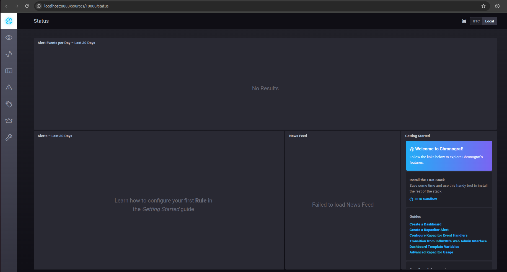
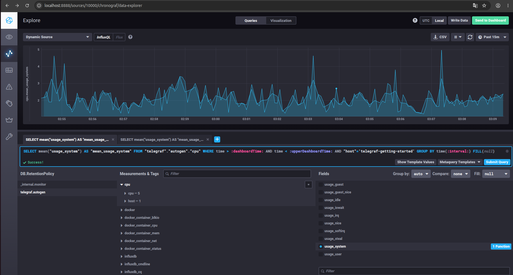
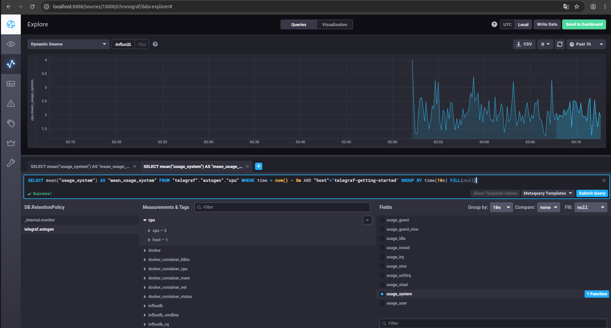
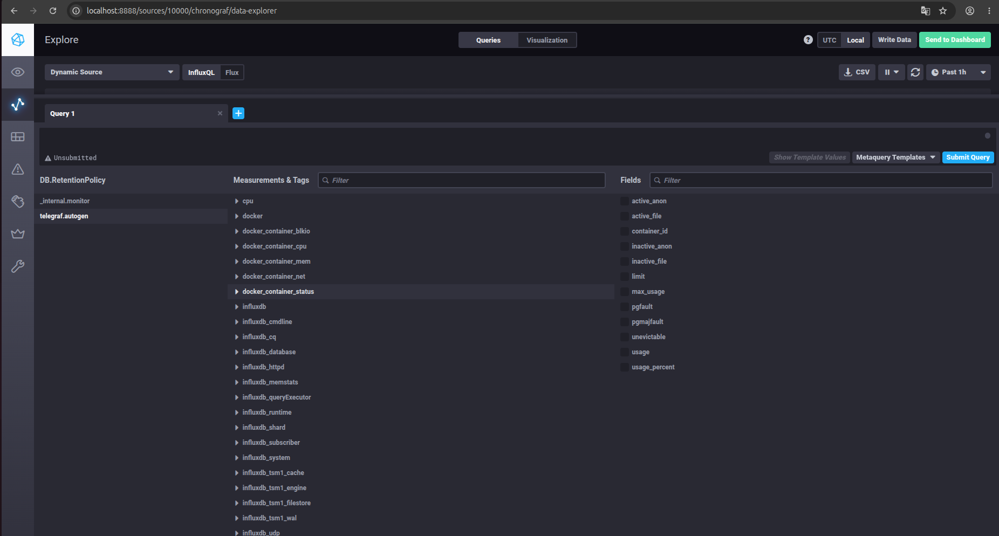

# Домашнее задание к занятию "`Системы мониторинга`" - `Минаевой Екатерины`

### Задание 1

Вас пригласили настроить мониторинг на проект. На онбординге вам рассказали, что проект представляет из себя платформу для вычислений с выдачей текстовых отчетов, которые сохраняются на диск. Взаимодействие с платформой осуществляется по протоколу http. Также вам отметили, что вычисления загружают ЦПУ. Какой минимальный набор метрик вы выведите в мониторинг и почему?   

### Решение 1

Для данного проекта минимальный и достаточный набор метрик разделяется на три уровня в разрезе двух методик:    
1. Метрики уровня приложения (HTTP-взаимодействие - Метод RED). Так как пользователи взаимодействуют с платформой по HTTP, важно видеть их клиентский опыт.   
- Rate (Интенсивность запросов): Количество HTTP-запросов в секунду (RPS).Это позволит оценить текущую нагрузку на платформу и фиксировать аномальные всплески.   
- Errors (Ошибки): Количество и доля ответов с кодами 5xx и 4xx. По своей сути это прямой индикатор деградации сервиса, рост ошибок скажет о сбоях в коде или инфраструктуре.   
- Duration/Latency (Длительность обработки): Время ответа сервера (желательно мониторить по перцентилям: p50, p95, p99). Так как платформа выполняет "тяжелые" вычисления, среднее значение не информативно, а перцентили смоут показать сколько времени ждут отчеты реальные пользователи.   

2. Метрики системных ресурсов (Метод USE). Учитывая высокую нагрузку на CPU и сохранение текстовых отчетов на диск, важно следить за тремя компонентами:   
- CPU Utilisation & Load Average: Процент утилизации процессора и глубина очереди потоков выполнения. В условии сказано что вычисления загружают ЦПУ, если утилизация упрется в 100%, то время генерации отчетов (Latency) катастрофически вырастет.   
- Memory (RAM) Utilisation: Объем занятой и свободной оперативной памяти. Если вычисления "выжрут" всю RAM, ОС активирует OOM Killer (Out of Memory) и завершит процесс платформы.   
- Disk Space & Inodes (Дисковая подсистема): Свободное место на диске (в байтах) и количество свободных индексов дескрипторов (inodes). В условии сказано что платформа генерирует текстовые отчеты и сохраняет их на диск. Текстовые файлы обычно весят мало, но их может быть очень много. Если закончатся inodes, ОС не сможет создать ни один новый файл, и платформа перестанет работать.   

---

### Задание 2

Менеджер продукта посмотрев на ваши метрики сказал, что ему непонятно что такое RAM/inodes/CPUla. Также он сказал, что хочет понимать, насколько мы выполняем свои обязанности перед клиентами и какое качество обслуживания. Что вы можете ему предложить?   

### Решение 2

Менеджеру продукта важен бизнес-контекст и пользовательский опыт. Чтобы решить его задачу, нужно предложить методологию SLA/SLO/SLI:    
1. SLI (Service Level Indicator - Индикатор качества обслуживания)    
- это конкретная метрика, которая определяет уровень успешности сервиса в процентах;    
- пример для проекта: "Доля успешных HTTP-ответов за последние Х минут" или "Доля вычисленных отчетов, которые сформировались быстрее чем за Х секунд".    
2. SLO (Service Level Objective - Целевой уровень качества)    
- целевое значение для SLI, которое команда обязуется выполнять;    
- пример для проекта: "Мы хотим, чтобы 99% всех запросов на генерацию отчетов обрабатывались без ошибок (5xx) в течение календарного месяца".    
3. SLA (Service Level Agreement - Соглашение об уровне обслуживания)   
- юридическое или бизнесовое обязательство перед клиентами, за нарушение которого бизнес несет финансовые или репутационные потери;   
- пример для проекта: "Если доступность сервиса падает ниже 95% за месяц, мы возвращаем клиентам 10% стоимости подписки".   
4. Error Budget (Бюджет на ошибку)   
- это производная от SLO. Если наше SLO - 99% успешных запросов, то 1% — это наш бюджет на ошибки.   
- зачем это менеджеру: показывает сколько сбоев платформа может себе позволить ради проведения экспериментов, деплоя нового функционала или проведения технических работ, не нарушая обещаний перед клиентами.   
   
Итог для менеджера: Вместо RAM и CPU мы выведем на дашборд один главный показатель - "Процент счастливых пользователей" (Apdex или SLO выполнения отчетов). Если этот показатель зеленый, значит перед клиентами обязательства выполняются.   

---

### Задание 3

Вашей DevOps команде в этом году не выделили финансирование на построение системы сбора логов. Разработчики в свою очередь хотят видеть все ошибки, которые выдают их приложения. Какое решение вы можете предпринять в этой ситуации, чтобы разработчики получали ошибки приложения?   

### Решение 3

Когда нет ресурсов и инфраструктуры под полноценный ELK-стек или Grafana, развертывание которых требует много дисков и RAM, нужно использовать легковесные, бесплатные или альтернативные подходы для доставки ошибок разработчикам.   
Возможные решения:   
1. Внедрение Sentry.   
- Суть: Sentry - это система отслеживания ошибок, а не полноценный сборщик логов. Ее бесплатную open-source версию можно быстро поднять в Docker на одной небольшой виртуальной машине. Разработчики интегрируют SDK в код своего приложения.   
- Плюсы: Инструмент предназначен именно для разработчиков, он группирует одинаковые ошибки, показывает stack trace, окружение и отправляет алерты. Тратит мало ресурсов.   
2. Алертинг в Telegram или Slack напрямую из кода или через системный журнал   
- Суть: Если ошибок немного, можно настроить logger в приложении (или какой-нибудь легковесный агент (например, Vector или Fluent Bit), читающий локальные логи), чтобы при появлении уровня ERROR или CRITICAL сообщение отправлялось напрямую через вебхук в рабочий чат разработчиков.   
- Плюсы: Нулевые затраты на инфраструктуру хранения, ошибки видны в реальном времени.   
3. Использование стандартного systemd-journald и journalctl с общим доступом   
- Суть: Если приложения работают как systemd-сервисы в Linux, они уже пишут все ошибки (stdout/stderr) в бинарный системный журнал.   
- Плюсы: Инфраструктура уже готова. Достаточно дать разработчикам ограниченный SSH-доступ на чтение логов конкретного сервиса, либо настроить простейшую веб-оболочку для journald, чтобы они могли смотреть логи через браузер без терминала.   

---

### Задание 4

Вы, как опытный SRE, сделали мониторинг, куда вывели отображения выполнения SLA=99% по http кодам ответов. Вычисляете этот параметр по следующей формуле: summ_2xx_requests/summ_all_requests. Данный параметр не поднимается выше 70%, но при этом в вашей системе нет кодов ответа 5xx и 4xx. Где у вас ошибка?   

### Решение 4

В формуле расчета SLA допущена ошибка классификации HTTP-кодов, т.е. полностью проигнорированы успешные перенаправления (коды 3xx).
Ответы 3xx (например, 301 Moved Permanently, 302 Found или 304 Not Modified) не являются ошибками. Например:   
- если платформа использует авторизацию (Keycloak, OAuth2), она может редиректить пользователя;   
- если клиент (браузер) активно кэширует текстовые отчеты, сервер на повторный запрос вернет код 304 Not Modified, сообщая, что файл не изменился. Для пользователя это успешный и мгновенный опыт, но формула посчитает это сбоем.   

---

### Задание 5

Опишите основные плюсы и минусы pull и push систем мониторинга.   

### Решение 5

Pull-системы мониторинга.    
Плюсы:   
- Контроль живости. Если сервер мониторинга не смог достучаться до приложения, то сразу можно получить алерт о том что хост недоступен. В push-модели тишина от агента может означать как его смерть, так и то, что на нем просто нет нагрузки.   
- Защита от перегрузки сервера. Сервер опрашивает таргеты с четко заданной частотой. Т.е. в случае когда приложение резко начнет генерировать миллионы запросов, сервер мониторинга не "ляжет" от лавины метрик, он продолжит собирать их в своем темпе.   
- Удобство отладки. Достаточно зайти через браузер или curl на endpoint приложения, чтобы увидеть какие метрики оно отдает в текстовом виде.   
- Централизованная конфигурация. Список всех отслеживаемых ресурсов хранится и управляется в одном месте - на сервере мониторинга.   
Минусы:   
- Сетевая связность. Сервер мониторинга должен иметь прямой сетевой доступ ко всем серверам и контейнерам. Если приложения находятся за NAT или в закрытых сегментах сети, приходится строить сложные прокси-схемы.   
- Проблема эфемерных задач. Если запускается cron-скрипт или serverless-функция, которая отрабатывает за 2 секунды, то pull-сервер просто не успеет узнать об их существовании (так как он опрашивает систему раз в 15 секунд).      

Push-системы мониторинга.   
Плюсы:   
- Идеально подходит для динамических сред и Serverless. Задачи, которые быстро открываются и закрываются, могут легко отправить метрику перед своим завершением.   
- Простая работа с сетью. Приложениям достаточно знать только один IP-адрес/DNS центрального сервера мониторинга, т.е. не нужно открывать порты приватных контуров для проверяющих систем.   
- Метрики событий высокой плотности. Позволяет отправлять метрики в режиме реального времени сразу по факту события.   
Минусы:   
- Риск падения сервера. При резком скачке нагрузки тысячи агентов одновременно начнут слать много метрик, что может легко перегрузить и уронить базу данных мониторинга.   
- Сложность детекции "молчаливой смерти". Если приложение зависло или упало, оно просто перестает слать данные. Чтобы понять что сервис мертв, серверу приходится высчитывать сложные метрики отсутствия данных.   
- Управление версиями агентов. Логика сбора и отправки размазана по конечным хостам. Если нужно изменить формат метрик, придется обновлять конфигурации или код на сотнях клиентов.   

---

### Задание 6

Какие из ниже перечисленных систем относятся к push модели, а какие к pull? А может есть гибридные?   
- Prometheus   
- TICK   
- Zabbix   
- VictoriaMetrics   
- Nagios   

### Решение 6

1. Prometheus   
- Модель: Pull (базовая). Prometheus изначально проектировался как чистая pull-система. Сервер регулярно опрашивает настроенные эндпоинты.   
- Гибридность: Имеет официальный "костыль" Pushgateway. Короткоживущие задачи пушат в него метрики, а Prometheus забирает их оттуда по pull-модели.   
  

2. TICK    
- Модель: Push (базовая). Главный агент сбора в этом стеке - Telegraf. Он собирает метрики и отправляет их в InfluxDB.   
- Гибридность: Сам агент Telegraf является гибридным. Он может как опрашивать сторонние сервисы (pull-плагины для nginx, prometheus), так и принимать входящие данные, но итоговая доставка в InfluxDB всегда идет по push-модели.   
   

3. Zabbix   
- Модель: Гибридная. Исторически Zabbix сочетал оба подхода:   
    - Zabbix Agent (Passive) - сервер опрашивает агент (pull).   
	- Zabbix Agent (Active) - агент сам собирает данные и отправляет на сервер (push).   
	- Также он активно использует pull при опросе сетевого оборудования по SNMP. В современных инсталляциях чаще используют активные агенты (push), чтобы разгрузить сервер.   
   

4. VictoriaMetrics   
- Модель: Гибридная. VictoriaMetrics разрабатывалась как масштабируемая альтернатива Prometheus, поэтому поддерживает оба метода одинаково хорошо:   
	- умеет сама ходить и опрашивать цели по pull-модели (как Prometheus);   
	- нативно принимает push-трафик по протоколам Prometheus remote_write, InfluxDB, Graphite и OpenTelemetry.   
   

5. Nagios   
- Модель: Pull (базовая). Работает по принципу активных проверок: сервер по расписанию запускает скрипты-плагины, которые идут на удаленные хосты и проверяют их состояние.   
- Гибридность: С помощью дополнения NSCA (Nagios Service Check Acceptor) систему можно перевести в пассивный режим, когда хосты сами шлют алерты (push), но это не является основным сценарием использования.   
   

---

### Задание 7

Склонируйте себе репозиторий и запустите TICK-стэк, используя технологии docker и docker-compose.   
В виде решения на это упражнение приведите скриншот веб-интерфейса ПО chronograf (http://localhost:8888).   

### Решение 7

   

---

### Задание 8

Перейдите в веб-интерфейс Chronograf (http://localhost:8888) и откройте вкладку Data explorer.   
- Нажмите на кнопку Add a query   
- Изучите вывод интерфейса и выберите БД telegraf.autogen   
- В `measurments` выберите cpu->host->telegraf-getting-started, а в `fields` выберите usage_system. Внизу появится график утилизации cpu.   
- Вверху вы можете увидеть запрос, аналогичный SQL-синтаксису. Поэкспериментируйте с запросом, попробуйте изменить группировку и интервал наблюдений.   
Для выполнения задания приведите скриншот с отображением метрик утилизации cpu из веб-интерфейса.   

### Решение 8

   
   

---

### Задание 9

Изучите список telegraf inputs. Добавьте в конфигурацию telegraf следующий плагин.   
Дополнительно вам может потребоваться донастройка контейнера telegraf в `docker-compose.yml` дополнительного volume и режима privileged.   
После настройке перезапустите telegraf, обновите веб интерфейс и приведите скриншотом список `measurments` в веб-интерфейсе базы telegraf.autogen. Там должны появиться метрики, связанные с docker.   

### Решение 9

   

---
