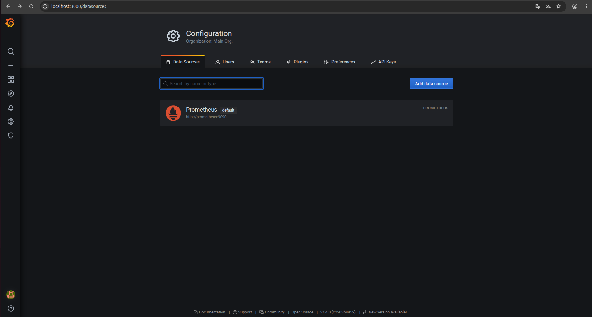
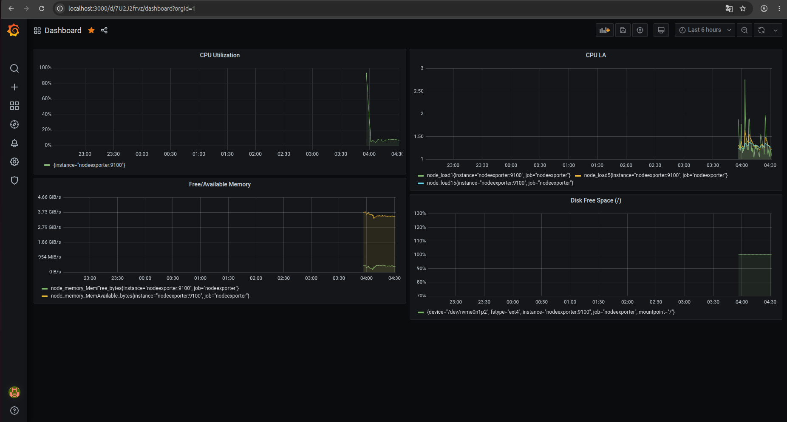
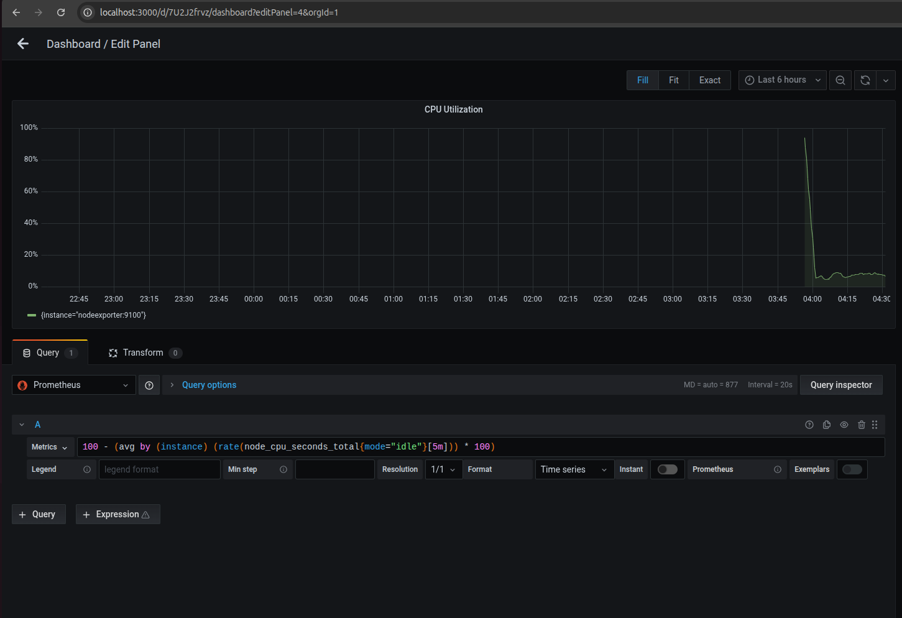
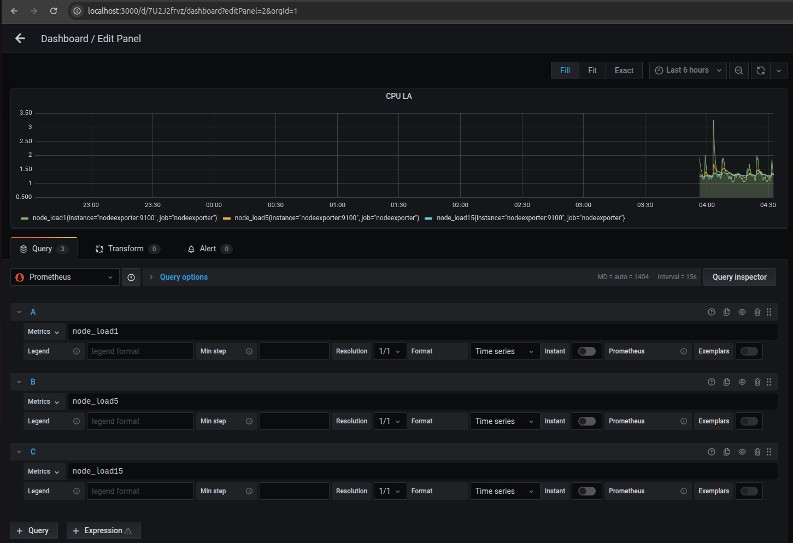
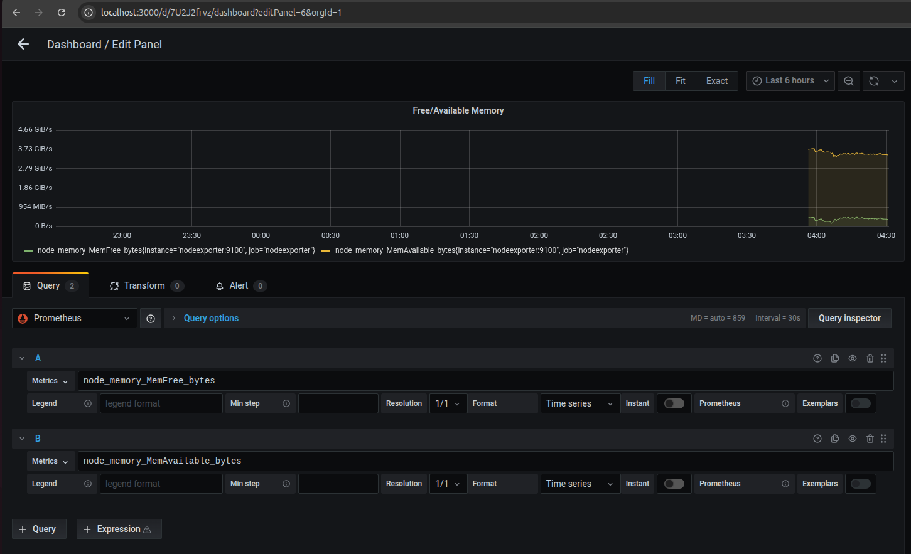
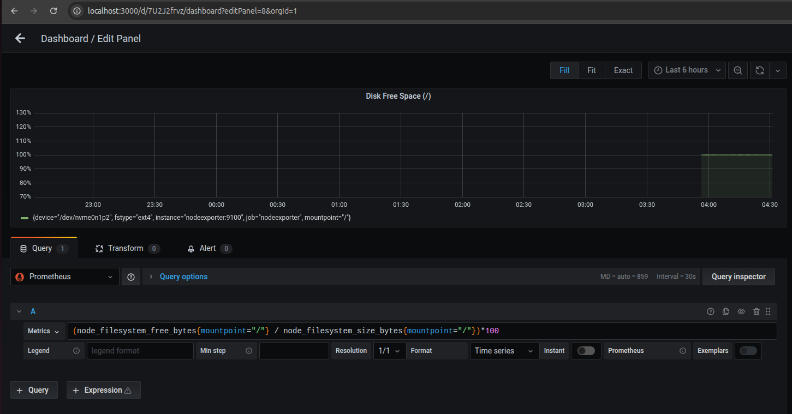
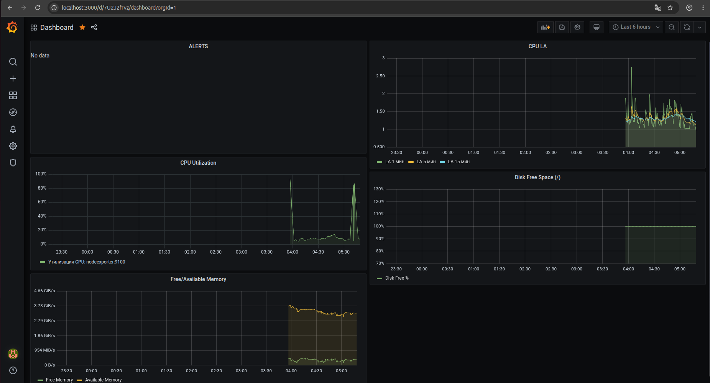

# Домашнее задание к занятию "`Средство визуализации Grafana`" - `Минаевой Екатерины`

### Задание 1

1. Используя директорию `help` внутри этого домашнего задания, запустите связку `prometheus-grafana`.
2. Зайдите в веб-интерфейс `grafana`, используя авторизационные данные, указанные в манифесте `docker-compose`.
3. Подключите поднятый вами `prometheus`, как источник данных.
4. Решение домашнего задания — скриншот веб-интерфейса `grafana` со списком подключенных `Datasource`.

### Решение 1

   

---

### Задание 2

1. Изучите самостоятельно ресурсы.
2. Создайте `Dashboard` и в ней создайте `Panels`:
- утилизация CPU для nodeexporter (в процентах, 100-idle);
- CPULA 1/5/15;
- количество свободной оперативной памяти;
- количество места на файловой системе.
3. Для решения этого задания приведите `promql-запросы` для выдачи этих метрик, а также скриншот получившейся `Dashboard`.

### Решение 2

  
  
  
  
   

---

### Задание 3

1. Создайте для каждой `Dashboard` подходящее правило `alert` — можно обратиться к первой лекции в блоке «Мониторинг».
2. В качестве решения задания приведите скриншот вашей итоговой `Dashboard`.

### Решение 3

   

---

### Задание 4

1. Сохраните ваш `Dashboard`.Для этого перейдите в настройки `Dashboard`, выберите в боковом меню `«JSON MODEL»`. Далее скопируйте отображаемое json-содержимое в отдельный файл и сохраните его.
2. В качестве решения задания приведите листинг этого файла.

### Решение 4

Приложен `Dashboard.json`

---
