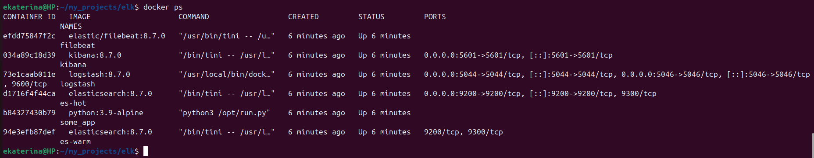
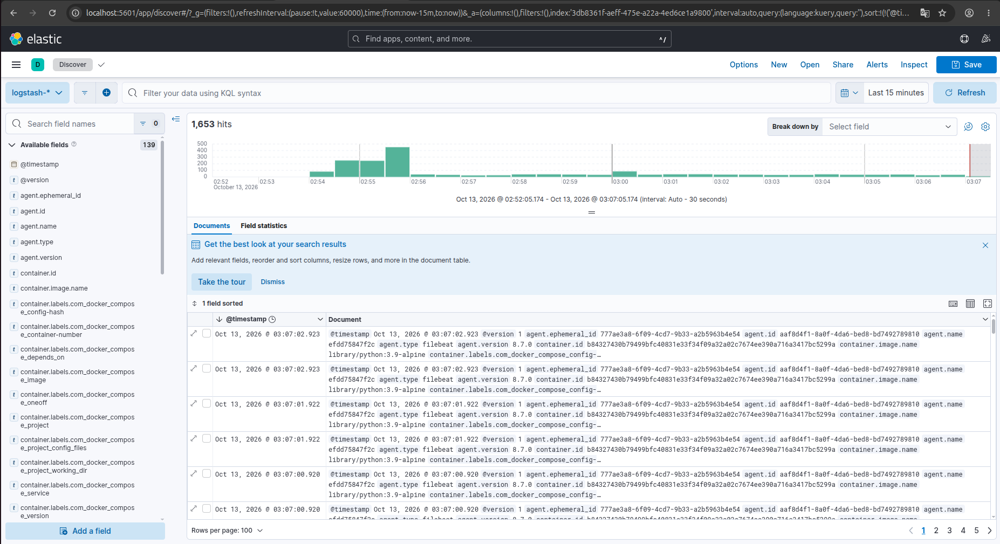
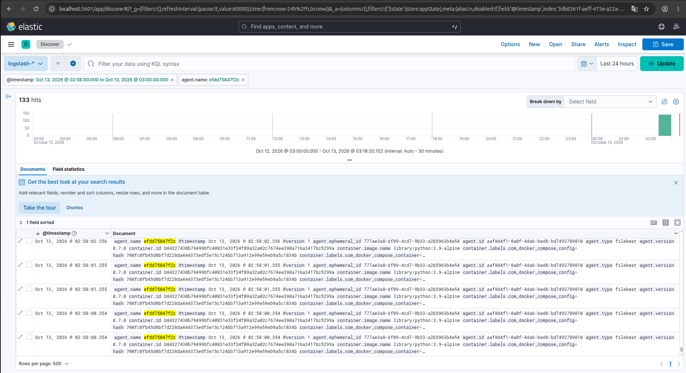

# Домашнее задание к занятию "`Система сбора логов Elastic Stack`" - `Минаевой Екатерины`

### Задание 1

Вам необходимо поднять в докере и связать между собой:
- elasticsearch (hot и warm ноды);
- logstash;
- kibana;
- filebeat.   
Logstash следует сконфигурировать для приёма по tcp json-сообщений.   
Filebeat следует сконфигурировать для отправки логов docker вашей системы в logstash.   
В директории help находится манифест `docker-compose` и конфигурации filebeat/logstash для быстрого выполнения этого задания.       

Результатом выполнения задания должны быть:
- скриншот docker ps через 5 минут после старта всех контейнеров (их должно быть 5);
- скриншот интерфейса kibana;

### Решение 1

   
   

---

### Задание 2

Перейдите в меню создания index-patterns в kibana и создайте несколько index-patterns из имеющихся.   
Перейдите в меню просмотра логов в kibana (Discover) и самостоятельно изучите, как отображаются логи и как производить поиск по логам.   
В манифесте директории help также приведенно dummy-приложение, которое генерирует рандомные события в stdout-контейнера. Эти логи должны порождать индекс logstash-* в elasticsearch. Если этого индекса нет — воспользуйтесь советами и источниками из раздела «Дополнительные ссылки» этого задания.   

### Решение 2

  

---
